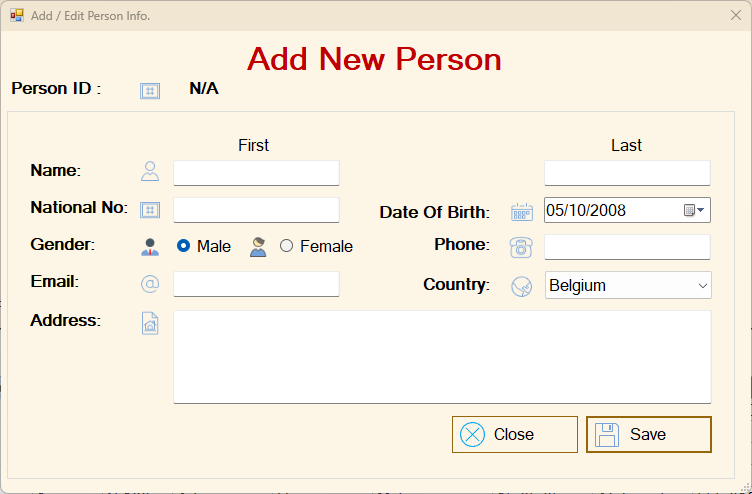
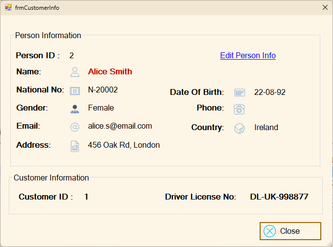
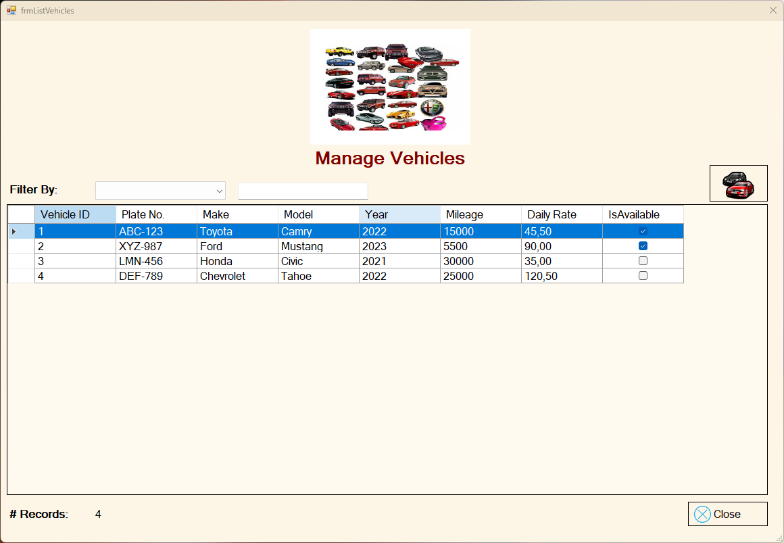
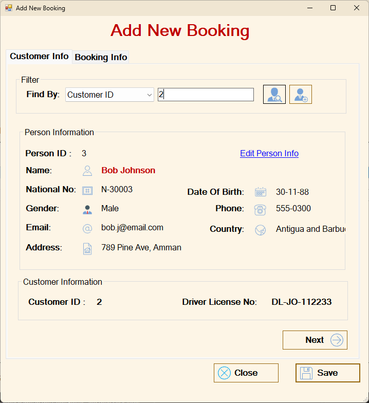
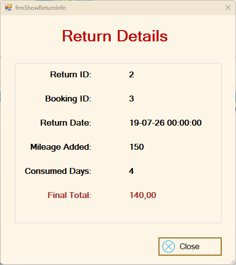
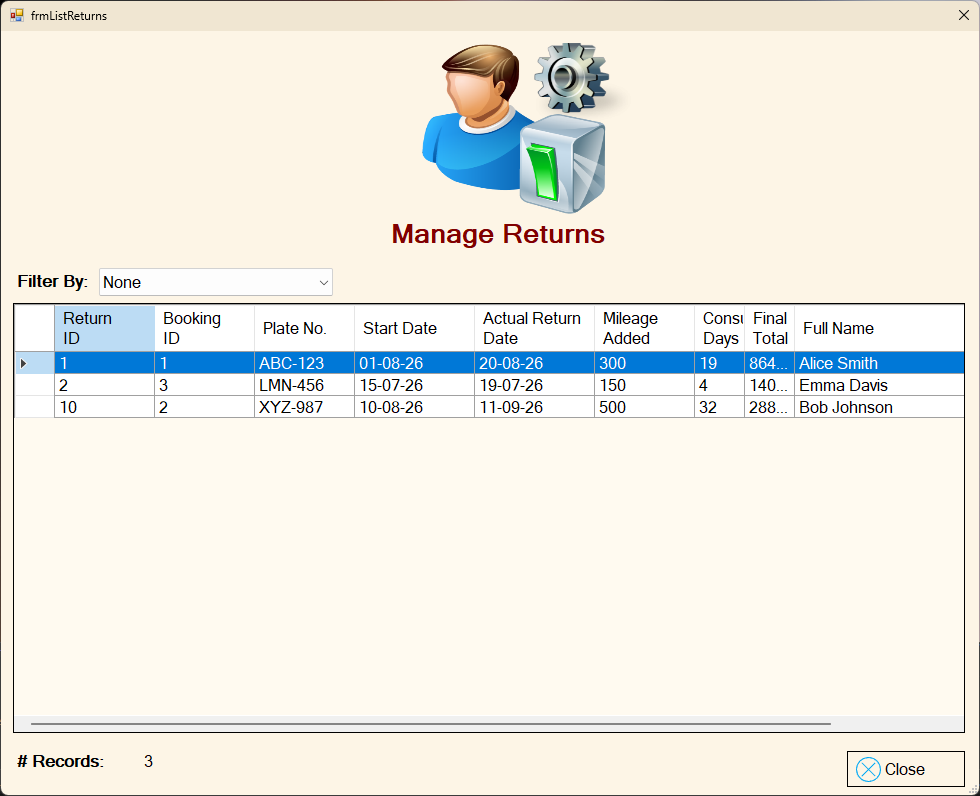

# 🚗 Car Rental Management System

A simulated enterprise desktop application for a Car Rental agency. Built with C#, .NET Windows Forms, ADO.NET, and SQL Server using a strict 3-tier architecture.

## 📖 Project Context
This application was developed as a parallel capstone project following the Programming Advices software engineering roadmap (Course 19). The objective was to solidify the concepts learned in the DVLD project by independently designing and building a fully functional, 3-tier desktop application from scratch without relying on step-by-step tutorials, proving mastery over enterprise system architecture.

---

## 🔍 Overview
The Car Rental System is a robust desktop application designed to manage the core operations of a vehicle rental business. Built using **C#**, **.NET Windows Forms**, **ADO.NET**, and **Microsoft SQL Server**, it strictly follows a **3-Tier Architecture** (Presentation, Business Logic, and Data Access layers) to ensure clean, maintainable, scalable, and decoupled code.

---

## ✨ Key Features
*   **Vehicle Fleet Management:** Full CRUD operations to manage the vehicle catalog, including Make, Model, Year, Mileage, and Daily Rate, with dynamic availability tracking.
*   **Customer & User Administration:** Multi-layered identity management separating base People profiles from Customers and System Users, ensuring no duplicate National ID entries.
*   **Booking Operations:** Manages vehicle reservations, automatically calculating initial totals based on rental days and daily rates, while enforcing strict date logic and preventing double-booking of unavailable vehicles.
*   **Return Module & Late Fees:** Processes completed rentals, calculates exact consumed days, applies late fees if necessary, updates total vehicle mileage, and automatically releases vehicles back to the available fleet.
*   **System Security:** Implements SHA-256 password hashing for secure database storage and utilizes Windows DPAPI encryption for local registry "Remember Me" credentials.

---

## 📸 Application Screenshots

### Authentication & Dashboard
> Login system with DPAPI encrypted credential saving and main navigation hub.

### Manage People & Customers
> Managing Person details, generating unique Person IDs, and linking them to Customer profiles with Driver's Licenses.

### Fleet & Booking Operations
> Managing vehicle availability and processing new rental bookings with dynamic fee calculation.

### Returns & Final Settlements
> Processing vehicle returns, calculating consumed days, and updating fleet mileage.

---

## 🛠️ Tech Stack & Tools
*   **Language:** C#
*   **Framework:** .NET Framework (Windows Forms)
*   **Database:** Microsoft SQL Server
*   **Data Access:** ADO.NET
*   **Architecture:** 3-Tier Architecture (UI, Business, Data Access) + Object-Oriented Programming (OOP) principles.
*   **Security:** SHA-256 (Hashing).

---

## 🚀 Setup & Installation

1. **Database Setup:** 
   * Open SQL Server Management Studio (SSMS).
   * Execute the `.sql` script located in the `Database` folder to generate the schema and populate the essential lookup data (Countries, Sample Vehicles, default Admin user).
2. **Application Configuration:**
   * Open the solution (`.sln`) in Visual Studio.
   * Open the `clsDataAccessSettings` file within the Data Access Layer project.
   * Update the `ConnectionString` to match your local SQL Server instance name.
3. **Run:** 
   * Build the solution and start the application. 
   * Log in using `admin` for the username and `123` for the password.